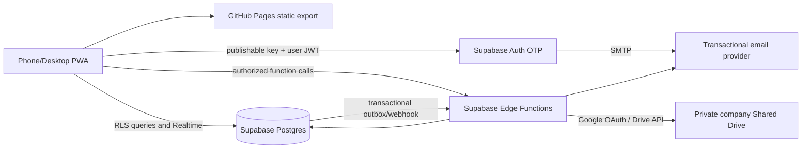

# Technical Design

## 1. Status and architecture decisions

**Delivery target:** complete application in beta; no separate MVP.  
**Frontend:** Next.js, React, TypeScript, responsive installable PWA.  
**Frontend hosting:** GitHub Pages via GitHub Actions static export.  
**Backend:** Supabase Auth, Postgres, RLS, Realtime and Edge Functions.  
**File storage:** Company Google Workspace Shared Drive, root folder `Forms MESRC`; 1 GiB maximum per file.  
**Product language:** English for all user-facing UI and system-generated emails.

Core rules:

- One company with multiple services; no multi-company tenancy.
- Roles: `maintenance`, `admin`, `user`. Maintenance accounts have equal privileges.
- Browser and public repository are untrusted. RLS and backend functions enforce access.
- No service-role key, Google refresh token, SMTP credential or other secret in static assets or public source.
- All privileged changes and sensitive file actions are audited.

## 2. System architecture

The deployed frontend is static HTML/CSS/JS. Build with Next.js static export and perform authenticated data access from the browser through Supabase. Do not use runtime-dependent API routes, Server Actions, middleware/proxy, request-specific server rendering or filesystem writes. Route/deep-link refresh must work on GitHub Pages. Account for repository `basePath`; prefer a custom domain if available, but it is not required for initial beta.

## 3. Frontend modules

- **PWA shell:** manifest, icons, install guidance, service worker, version notice, responsive navigation. Cache public static assets only; never cache authenticated API responses or user files.
- **Authentication:** invite acceptance, email entry, OTP request/verification, session restore, sign-out.
- **Authorization UX:** profile/role load, route navigation and denial states. This is UX only; RLS remains the security boundary.
- **User portal:** form catalog/renderer, optional drafts, submissions, appeal status, own tickets and profile.
- **Form builder:** template selection, drag/drop canvas nodes, property editor, responsive preview, draft/publish/version.
- **Admin workspace:** dashboard, submissions, appeals, tickets, ticket help/claim, forms and User management.
- **Maintenance console:** all Admin features, role invitations, company/service settings, Drive/email setup, connection checks, audit and usage health.
- **Shared:** validation, accessible components, file upload progress, realtime subscriptions, notifications and recoverable loading/error/empty/offline states.
- All user-facing content and system email templates are English.

## 4. Screen and route map

| Route | Access | Purpose |
|---|---|---|
| `/login` | invited accounts | Enter invited email and request OTP. |
| `/auth/verify` | invited accounts | Verify OTP; handle expiry, invalid code and resend throttle. |
| `/invite/accept` | invited accounts | Validate invite token/status; invitation itself does not create a session. |
| `/app` | signed-in | Role-based landing. |
| `/app/forms`, `/app/forms/[slug]` | eligible users | Catalog, accessible form rendering, validation, timer, optional draft, file upload and submit. |
| `/app/my-submissions` | users | Own submissions and appeal status. |
| `/app/tickets`, `/app/tickets/[ticketNo]` | users | Own ticket status/history and contact guidance. |
| `/admin` | Admin/Maintenance | Real-time operational dashboard. |
| `/admin/forms/**` | Admin/Maintenance | List, build, preview, publish and version forms. |
| `/admin/submissions/**` | Admin/Maintenance | Search, filter, paginate and inspect authorized submissions. |
| `/admin/appeals/**` | Admin/Maintenance | Review and decide appeals. |
| `/admin/tickets/**` | Admin/Maintenance | Claim, progress, request help, transfer, resolve, close and inspect history. |
| `/admin/users` | Admin/Maintenance | Admin invites Users; Maintenance invites all roles and manages role assignments. |
| `/maintenance/settings` | Maintenance only | Company/service configuration and guided Drive/email setup. |
| `/maintenance/audit` | Maintenance only | Security and administrative event history. |

Every screen requires loading, empty, access-denied, recoverable-error and network-loss states. User mobile form filling is the primary mobile path; desktop administration is the primary desktop path.

## 5. Invitation and OTP flow

1. Caller invokes `create-invite` Edge Function. It validates caller role and allowed invite role, normalizes email, records optional service membership, creates a short-lived invitation token hash and audit event, and enqueues the invitation email.
2. Invite email links to `/invite/accept`. The app submits the opaque token to a backend function; the backend validates expiry/revocation and marks acceptance. Token acceptance alone does not authenticate.
3. Login screen submits the email to an invite-gated OTP function. The function checks active invite/profile, applies per-email/IP throttles and abuse controls, then requests Supabase Auth OTP using server-side credentials and configured SMTP. This prevents sending OTP to uninvited addresses.
4. User enters OTP; Supabase Auth verifies it and creates the session.
5. The app loads active profile and role. RLS blocks missing, disabled or revoked accounts.
6. Audit invite/OTP request and verification outcomes without recording OTP values or raw tokens. Use generic endpoint responses to reduce email enumeration.

Supabase service-role/secret keys belong only in Edge Function secrets. Never put them in `NEXT_PUBLIC_*`, GitHub Pages build artifacts or repository files. Add CAPTCHA if abuse patterns warrant it.

## 6. Email architecture

All templates and UI copy are English. Use Supabase Auth SMTP for OTP/invitation authentication messages as supported by the chosen flow. Use Edge Functions and a transactional outbox for application notifications:

- New complaint: notify all Admins.
- Ticket claim: notify all other Admins and identify the owner.
- Help request: notify the invited helper; notify the owner on accept/decline.
- Ownership transfer and ticket status: notify involved Admins and requester as applicable.
- Optional form/appeal events according to settings.

`email_outbox` fields: event ID, recipient, template key, minimal variables, related resource, status (`pending/sending/sent/failed`), attempts, next retry, provider ID, timestamps and sanitized error. Use idempotency keys and retries. Email contains ticket number, service, safe short summary and authenticated link; keep sensitive details in the portal. Provider is configurable; verify Workspace/Gmail policy, quotas and sender authentication before beta.

## 7. Database model

Use UUID primary keys and UTC `timestamptz`; normalize email. Store file bytes only in Drive.

| Table | Purpose/key data |
|---|---|
| `company_settings` | Single company identity, timezone, branding and global settings. |
| `services` | Company services/operations and active/sort state. |
| `profiles` | Auth user ID, email, display name, phone, role, active state. |
| `profile_services` | Many-to-many user/service membership. |
| `invites` | Normalized email, role, inviter, token hash, expiry, accepted/revoked state. |
| `forms` | Owner, service links, kind, state, access mode, current version. |
| `form_versions` | Immutable numbered schema/theme JSON and publication metadata. |
| `form_email_allowlist` | Exact normalized email restrictions; empty means all invited active Users. |
| `submissions` | Form/version/service/user, answer JSON, status, start/submit/duration. |
| `submission_files` | Submission, Drive file ID, folder ID, original name, MIME, byte size, checksum, uploader and upload state. No file bytes. |
| `appeal_reviews` | Status, reviewer, request/decision reason and timestamps. |
| `tickets` | Ticket number, submission/service/requester/category/priority/status, `owner_admin_id`, timestamps. |
| `ticket_help_requests` | Ticket, owner, invited helper, note, state (`pending/accepted/declined/cancelled`) and timestamps. |
| `ticket_helpers` | Ticket-scoped helper grants and active interval; separate from owner. |
| `ticket_events` | Append-only status, claim, help and transfer history with actor/time. |
| `audit_events` | Sensitive administrative/security events; no OTP, token or answer payloads. |
| `email_outbox` | Retryable, idempotent email delivery state. |

Keep access-critical columns typed. Use JSONB only for form schema/answers. Index form/service/status/date, user/date, ticket number/status, normalized email and outbox retry fields. Add uniqueness constraints for ticket numbers, version numbers, token hashes and allowlist pairs.

## 8. Authorization and RLS

Enable RLS on every exposed table; default deny. Google Drive is private and accessed only after backend authorization. UI/route guards do not grant security.

| Operation | Maintenance | Admin | User |
|---|---|---|---|
| Company/service settings | read/write | read | read labels as needed |
| Invite Maintenance | yes | no | no |
| Invite Admin | yes | no | no |
| Invite/manage User | yes | yes | no |
| Build/publish forms | yes | yes | no |
| Read published forms | yes | yes | active invited user + published + allowlist eligible |
| Read submissions | company-wide | company-wide | own only |
| Claim unowned ticket | yes, audited override | atomic first claim | no |
| Progress owned ticket | yes, audited override | owner only | no |
| Help ticket | yes | owner may invite; helper sees ticket-scoped data after acceptance | no |
| Read ticket | all | all | own only |
| Assign roles | through trusted function | no | no |
| Integration settings/secrets | configure via protected function; secret write-only | no | no |
| Audit | all | operational subset if allowed | no |

All active invited Users can access published forms unless that form has an email allowlist. Service membership organizes reporting and does not silently limit form access. Prevent recursive RLS helper logic and lock down any `SECURITY DEFINER` functions with fixed `search_path`. Beta security checks cover owner isolation, allowlists, disabled users, role escalation, ticket claim races, helper scope and file access.

## 9. Form and submission lifecycle

Form: `draft → published → archived`. Editing a published form creates a new draft version; published versions are immutable. Archiving prevents new submissions but preserves history. Submissions reference an exact version.

Submission: optional `draft → submitted`. Autosave is enabled only by form policy and never implies submission. On submit, the backend revalidates form version/access, required fields, types, options and limits. Builder nodes have stable IDs, field type, label/help, required/validation, options and presentation properties. Theme/layout values are whitelisted; arbitrary HTML/JS is forbidden.

## 10. Appeals and ticket lifecycle

Appeals use controlled states: `submitted → in_review → needs_information → approved/rejected`. Every transition records actor, time and optional reason. Whether users can respond to `needs_information` is a setup-time product confirmation.

Ticket states: `open → in_progress → resolved → closed`; owner/Admin Maintenance may reopen `in_progress` or `resolved` to `open` with an audited event. Any Admin can atomically claim an unowned Open ticket using **Take Ticket**; the operation sets `owner_admin_id`, changes status to In Progress and queues notices to all other Admins. Only the owner advances normal status. Maintenance may override with an audited reason.

Owner help workflow: owner selects **Request Help**, chooses another Admin and may add a note. The invited Admin accepts/declines. Acceptance grants scoped ticket access without changing ownership. Owner may explicitly transfer ownership. Each request, response, grant, transfer, claim and status transition writes an immutable `ticket_events` entry and email-outbox event in the same database transaction. External calls/WhatsApp remain outside the system.

## 11. Google Drive attachments

Use the company Google Workspace Shared Drive with root folder **Forms MESRC**. Store files beneath stable app-generated user and submission IDs, e.g. `Forms MESRC/{user_id}/{submission_id}/`; never use email or user-supplied names in paths. Configure the root folder ID as a server-side setting. Do not create a Shared Drive per user.

Maximum file size is **1 GiB (1,073,741,824 bytes)**, also bounded by available company quota and API constraints. Postgres stores metadata/Drive IDs only.

Upload flow:

1. Browser requests an upload session through an Edge Function with submission, declared size, MIME and name.
2. Function verifies session, role, form allowlist, editability, size/type policy and quota policy; it creates a private Drive object and pending metadata row.
3. Function returns a short-lived Drive resumable-upload session URI. Browser uploads bytes directly to Google with progress and retry/resume. Treat the URI as a bearer capability: do not log/email it or persist it unnecessarily.
4. Browser calls finalize. Backend checks Drive object, actual size and ownership, then marks metadata complete; invalid/oversized/orphaned objects are deleted.
5. Download/delete requests go through backend authorization. Stream the file or return a short-lived capability. Never use public link sharing.

Allowlist file types, validate actual size/content where feasible, audit upload/download/delete and define retention/malware policy. Workspace IT must authorize the Drive API and integration identity. Prefer an approved identity with access to the company Shared Drive. Service accounts have no personal quota and cannot own files; files must be created inside the Shared Drive. If human OAuth is required, use a company-managed account and store refresh credentials only as Edge Function secrets.

## 12. Maintenance integration setup UX

Only Maintenance sees Settings. Admin has no route, navigation item or API permission for these settings. Sections:

- **Google Workspace/Drive:** company account, Shared Drive/root folder, API connection state, last validation, quota signal and credential rotation.
- **Email:** sender/provider, SMTP or provider settings, test-send and delivery health.
- **Company/services:** company name, service list and active state.
- **Security/operations:** invitation policy, upload policy, retention, audit and quota status.

Every integration section includes an English information icon. Hover/focus/click opens accessible instructions: prerequisites, where to find each value, step-by-step setup, validation action, common errors and official documentation link. Forms show `Not configured`, `Configured` and `Connection failed` plus last checked timestamp; secret values are write-only and never returned after save. Provide replace/rotate and clear with confirmation.

Because GitHub Pages is static, browser cannot securely save service credentials directly. A protected first-time setup flow must send a secret over HTTPS to a narrowly authorized Edge Function that writes it to Supabase project secrets and returns only success/failure. The exact authorization for this bootstrap operation must be designed before implementation; do not create an unauthenticated secret-setting endpoint. If Supabase project secrets cannot safely be managed at runtime, document initial admin setup in Supabase Dashboard and make the UI a guided status/validation panel instead of pretending to edit secrets.

## 13. Realtime

Subscribe narrowly to submissions, ticket rows and counts. Realtime authorization follows RLS. On reconnect, refetch canonical paginated data; do not depend on socket events for durability. Avoid broadcasting answer payloads to dashboard counters.

## 14. PWA and GitHub Pages deployment

- Export static assets and publish with GitHub Actions to GitHub Pages.
- Configure Supabase Auth redirect URLs for production and approved test URLs.
- Handle repository base path or configure a custom domain. Test direct open and refresh for every nested route.
- PWA manifest has name, icons, `start_url`, `standalone` display and theme colors.
- Service worker caches versioned public assets only. No API response, personal data, form answer, ticket or file cache.
- Only Supabase project URL and publishable key are public build settings; no service role, SMTP or Google secret.
- Restrict deployment to protected branch and review/pin GitHub Actions dependencies.
- Email is fallback for push, which varies across browser/platform.

## 15. Environments and operations

Separate development and beta Supabase projects where practical. Public previews use synthetic data and never point to production by default. Keep SQL migrations reviewed and versioned; never run schema changes from browser. Monitor Auth/SMTP, Edge Function failures, outbox backlog, Drive quota/API errors, Supabase quotas, project pause state, failed login trends and backup/export readiness.

Before sensitive HR/medical information is stored, company privacy/security, retention and backup policy must be approved. Free-tier sufficiency is an assumption to monitor, not an uptime or backup guarantee.

## 16. Complete beta readiness gates

All complete product workflows must be implemented, then verify:

1. Invite matrix, OTP gating, expiry, revocation, resend throttling and abuse controls.
2. RLS and role-escalation prevention; allowlist and owner isolation.
3. Form builder, versions, submissions and attachments.
4. Appeal decisions and ticket claims/help/transfers/status emails with retry idempotency.
5. Realtime updates, reconnect reconciliation and pagination.
6. PWA installation/update, nested route refresh, mobile User and desktop Admin flows.
7. Accessibility, validation and loading/empty/error/offline states.
8. Drive quota monitoring, synthetic-data restore/backup drill and no secrets in public assets.
9. Beta feedback, known-issues log and rollback procedure.

Beta allows improvement and known defects; it does not intentionally omit core workflows.

## 17. Setup-time confirmations

These require company access/policy and do not change the agreed product direction:

1. Workspace IT grants the application integration required Drive API access to `Forms MESRC` in the company Shared Drive.
2. Confirm actual Drive quota, file type allowlist, retention/deletion policy; per-file maximum is fixed at 1 GiB.
3. Confirm initial service names and who may add services.
4. Select transactional email provider/sender and confirm quotas/policy.
5. Confirm beta URL/custom domain and GitHub Pages repository path.
6. Confirm appeal decision authority and whether a User can respond to `Needs Information`.
7. Confirm data retention, deletion permissions, backup/export ownership and online/offline draft behavior.

